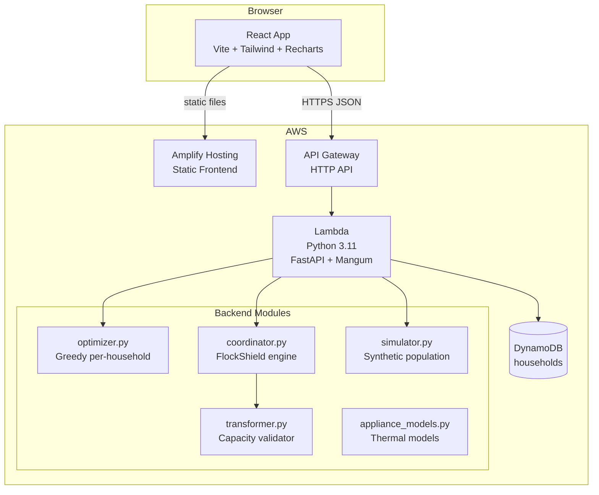

# Murmuration

**Many homes. One intelligent grid.**

> Environmental Hacks — Bharat Builds Tour, Event 02 | Track: Waste and Energy | Team: Hackit247

[](#tests)
[](#local-setup)
[](#aws-deployment)

---

## The Problem

India's Electricity (Rights of Consumers) Amendment Rules, 2023 bring Time-of-Day (ToD) tariffs to domestic consumers as smart meters roll out. Midday is cheap and clean (solar generation). Evening is expensive and dirty (coal-heavy peak demand).

**Individual optimization makes this worse.**

When thousands of homes each run their own appliance scheduler, they all shift EV charging and geysers to the same cheap periods simultaneously. This creates a new demand spike — a **rebound peak** — that can overload local distribution transformers and defeat the purpose of the price signal.

```
Unmanaged:   ░░░░▓▓▓▓▓▓▓▓▓░░   (evening peak from natural behaviour)
Independent: ░░░░░▓▓▓▓▓▓▓▓░░░  (rebound peak in solar band from synchronized shifts)
FlockShield: ░░░░░░▓▓▓░░▓░░░░  (coordinated spread across available capacity)
```

## The Solution: Murmuration + FlockShield

**Murmuration** is a neighbourhood energy coordination platform. Its core engine, **FlockShield**, schedules flexible appliance loads across households while respecting shared transformer capacities.

Unlike another individual bill calculator, Murmuration coordinates at the neighbourhood level to:
- Prevent rebound demand peaks
- Protect local transformer capacity limits  
- Preserve household cost savings and comfort constraints
- Measure the resulting financial and environmental impact

---

## Features

### Neighbourhood Dashboard (Flagship)
- **Three-strategy comparison**: Unmanaged baseline, independent optimization (rebound demo), and FlockShield coordination
- **Interactive load curve**: 48-slot demand chart showing all three strategies simultaneously
- **Transformer map**: Schematic neighbourhood map with utilization status for each transformer
- **FlockShield decision log**: Real scheduling decisions explaining every appliance movement
- **Scenario controls**: Adjust homes, EV adoption, AC rate, solar, tariff, and transformer capacity
- **KPI metrics**: Peak demand, PAR, transformer utilization, cost savings, CO₂ avoided

### Household Optimizer
- Greedy tariff-aware appliance scheduler
- Template quick-add for EV, Geyser, AC, Washing Machine, Dishwasher, Water Pump
- Weekly schedule grid with tariff band backgrounds
- Before/after cost and carbon charts
- Shareable profile link (no login required)
- DynamoDB profile persistence

---

## Screenshots

> *(Screenshots to be added after first deployment)*

| Neighbourhood Dashboard | Household Optimizer |
|---|---|
| `[screenshot]` | `[screenshot]` |

---

## Architecture



---

## Tech Stack

| Layer | Technology |
|---|---|
| Frontend | React 18, Vite, Tailwind CSS, Recharts, lucide-react |
| Backend | Python 3.11, FastAPI, Pydantic v2, Mangum |
| Compute | AWS Lambda (512 MB, 60s timeout) |
| API | AWS API Gateway HTTP API |
| Database | AWS DynamoDB (on-demand billing) |
| Hosting | AWS Amplify Hosting |
| IaC | AWS SAM CLI |

---

## Local Setup

### Prerequisites
- Python 3.11+
- Node.js 18+
- pip

### Backend

```bash
cd backend
pip install -r requirements.txt

# Start the API server (no Docker needed)
uvicorn app:app --reload --port 8000
```

The API will be available at `http://localhost:8000`.
Interactive docs: `http://localhost:8000/docs`

### Frontend

```bash
cd frontend
npm install

# Start dev server (proxies /api to localhost:8000)
VITE_API_URL=http://localhost:8000 npm run dev
```

The app will be at `http://localhost:5173`.

---

## Tests

```bash
cd backend
python -m pytest tests/ -v
```

**52 tests covering:**
- Tariff expansion into 48-slot price and carbon arrays
- Correct kWh, INR, and carbon calculations
- Overnight appliance windows
- Fixed appliances that cannot be moved
- Sanctioned load constraints
- Transformer aggregate capacity constraints
- Geyser thermal model
- AC comfort model
- Infeasible scheduling detection
- Deterministic simulation results
- Rebound peak demonstration
- FlockShield load reduction
- API validation and error responses
- Performance (50/200/500 homes)

---

## AWS Deployment

### Prerequisites
- AWS CLI configured (`aws configure`)
- AWS SAM CLI installed (`pip install aws-sam-cli`)
- An S3 bucket for SAM artifacts (or use `--resolve-s3`)

### Steps

```bash
# 1. Copy and edit config
cp samconfig.toml.example samconfig.toml
# Edit samconfig.toml: set region, stack_name

# 2. Build
sam build

# 3. Deploy (first time: guided setup)
sam deploy --guided

# After deploy, note the HttpApiUrl output

# 4. Connect Amplify Hosting
# - Go to AWS Amplify Console
# - "Host a web app" → connect GitHub repo
# - Set build command: cd frontend && npm install && npm run build
# - Set environment variable: VITE_API_URL=<HttpApiUrl output>

# 5. Update CORS
# Edit template.yaml: add your Amplify domain to CorsConfiguration
# Re-deploy: sam deploy
```

### Environment Variables

| Variable | Where | Description |
|---|---|---|
| `VITE_API_URL` | Frontend (Amplify) | API Gateway endpoint URL |
| `HOUSEHOLDS_TABLE` | Lambda (auto-set by SAM) | DynamoDB table name |
| `CORS_ORIGINS` | Lambda | Comma-separated allowed origins |

---

## Example API Requests

```bash
# List tariffs
curl http://localhost:8000/tariffs

# Optimize a household
curl -X POST http://localhost:8000/optimize \
  -H "Content-Type: application/json" \
  -d '{
    "tariff_id": "tod-domestic-illustrative",
    "sanctioned_load_kw": 5,
    "appliances": [{
      "name": "EV charger",
      "power_kw": 3.3,
      "duration_min": 240,
      "days_per_week": 7,
      "current_start": "19:00",
      "earliest_start": "09:00",
      "latest_end": "07:00"
    }]
  }'

# Run neighbourhood simulation (all three strategies)
curl -X POST http://localhost:8000/simulate \
  -H "Content-Type: application/json" \
  -d '{
    "n_homes": 100,
    "n_transformers": 5,
    "transformer_capacity_kw": 200,
    "ev_adoption_rate": 0.6,
    "ac_adoption_rate": 0.4,
    "geyser_adoption_rate": 0.7,
    "tariff_id": "tod-domestic-illustrative",
    "seed": 42
  }'

# Save household profile
curl -X PUT http://localhost:8000/households/<uuid> \
  -H "Content-Type: application/json" \
  -d '{"tariff_id": "...", "sanctioned_load_kw": 5, "appliances": [...]}'
```

---

## Simulation Assumptions

All simulation data is **synthetic and illustrative**.

| Assumption | Value |
|---|---|
| Time resolution | 48 half-hour slots per day |
| Base load model | Simple demand curve (0.2–0.5 kW, varies by hour) |
| EV charger | 3.3 kW, 4-hour charge, plug-in after 18:00 |
| Geyser model | First-order thermal model, 25-litre, 2 kW |
| AC model | Single-zone thermal model, 1.5 kW, COP=3 |
| Carbon intensity | Approximated from CEA CO₂ Baseline Database |
| Tariff | Illustrative ToD tariff modelled on India's rules |
| Population seed | Deterministic — same seed → identical results |

---

## Limitations and Safety Caveats

1. **Synthetic data only** — no connection to real smart meters or DISCOM APIs
2. **Illustrative tariffs** — not actual electricity tariff rates; verify before quoting
3. **Carbon estimates** — approximate; based on grid-average emission factor
4. **Not certified grid protection** — FlockShield demonstrates capacity-constrained scheduling in simulation; it cannot guarantee safety of a real electrical grid
5. **Greedy heuristic** — FlockShield is not globally optimal; it uses a capacity-aware greedy scheduler
6. **Shifting ≠ saving energy** — scheduling changes reduce cost through tariff arbitrage, not total energy consumed
7. **Lambda timeout** — very large scenarios (>500 homes) may approach Lambda execution limits; benchmark before claiming support

---

## Team

**Hackit247** — Environmental Hacks, Bharat Builds Tour, Event 02

---

## Hackathon Compliance

| Criterion | How met |
|---|---|
| AWS open-source tool | AWS SAM CLI for local dev and deployment |
| Deployed on AWS | Lambda, API Gateway, DynamoDB, Amplify Hosting |
| Meaningful use of AWS | Not just a badge — Lambda runs the FlockShield engine |
| 3-minute demo video | Landing page shows simulation results without any form input |
| No personal data | Only UUID-identified profiles; no name, address, or meter ID |
