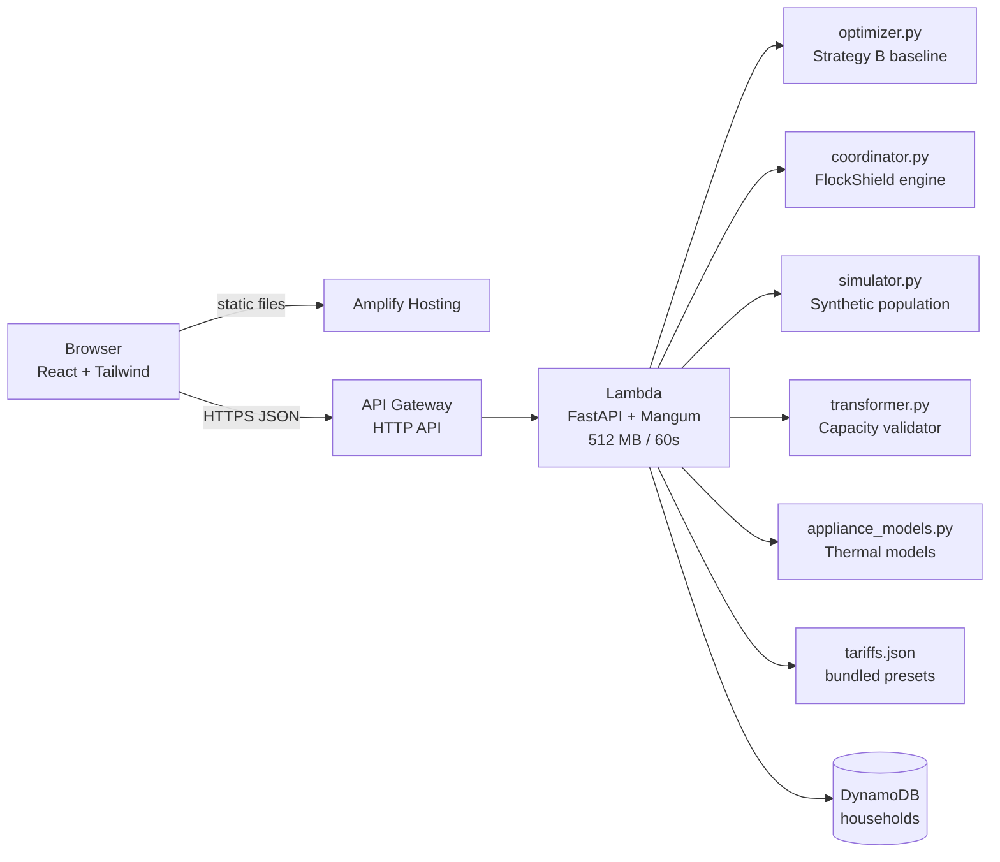

# Murmuration — Architecture

**Product:** Murmuration | **Engine:** FlockShield | **Team:** Hackit247

## 1. Overview

A React frontend calls a FastAPI backend deployed as a single Lambda function behind API Gateway. The backend hosts the FlockShield coordination engine, the household optimizer, the simulator, and the transformer validator. DynamoDB stores household profiles. AWS Amplify serves the frontend.



## 2. Components

| Component | Tech | Responsibility |
|---|---|---|
| Web app | React, Vite, Tailwind, Recharts, lucide-react | Neighbourhood dashboard, household optimizer, API integration |
| Hosting | AWS Amplify Hosting | Build from Git repo, serve over HTTPS |
| API | API Gateway HTTP API | Routing, CORS, throttling |
| Service | Lambda, Python 3.11, FastAPI + Mangum | Validation, FlockShield engine, persistence |
| Household optimizer | `optimizer.py` | Greedy tariff-aware scheduler (Strategy B baseline) |
| FlockShield | `coordinator.py` | Capacity-aware coordination across all homes (Strategy C) |
| Simulator | `simulator.py` | Synthetic population generation, three-strategy simulation |
| Transformer validator | `transformer.py` | Slot-level aggregate capacity checks |
| Appliance models | `appliance_models.py` | Geyser thermal model, AC thermal model, EV charger spec |
| Metrics | `metrics.py` | Compute all strategy metrics from actual schedule output |
| Tariff data | `tariffs.json` | Preset price and carbon curves |
| Store | DynamoDB, on-demand | One item per household profile |
| IaC | AWS SAM CLI | `sam local start-api`, `sam build`, `sam deploy` |

## 3. Key Design Decisions

| Decision | Chosen | Reason |
|---|---|---|
| Compute | Single Lambda | Always-free tier, no persistent cost, one deploy command |
| Backend framework | FastAPI + Mangum | Pydantic validation, local uvicorn for free, existing brief requirement |
| Database | DynamoDB | Simple get/put by UUID; RDS adds VPC, cost, and complexity for no benefit |
| Coordination | Greedy capacity-aware heuristic | Correct and fast for hackathon scale; MILP needed only for >20 appliances per home |
| Synthetic population | In-memory, seeded | No real meter data exists; deterministic seed enables reproducible tests |
| Lambda memory | 512 MB | Measured to be sufficient for 500-home simulation within timeout |
| Lambda timeout | 60s | Supports up to ~500 homes live; larger scenarios can use precomputed results |
| Auth | None (UUID in URL) | Nothing sensitive is stored; document limitation clearly |
| Frontend hosting | Amplify Hosting | Connect repo and deploy; no bucket or distribution to configure |

## 4. API

Base URL: output of `sam deploy` → `HttpApiUrl`. All bodies are JSON.

| Method | Path | Purpose |
|---|---|---|
| GET | `/tariffs` | List presets: id, name, 48 price slots, 48 carbon slots |
| POST | `/optimize` | Stateless. Body: profile. Returns household schedule + savings |
| PUT | `/households/{id}` | Save profile to DynamoDB |
| GET | `/households/{id}` | Load profile from DynamoDB |
| POST | `/simulate` | Run three-strategy neighbourhood simulation |
| POST | `/hosting-capacity` | Same request body as `/simulate`. Reruns the scenario at 0% to 100% EV adoption and returns the highest share the transformers can host under each strategy (up to 1,000 homes) |
| GET | `/health` | Health check |

### POST /simulate request

```json
{
  "n_homes": 100,
  "n_transformers": 5,
  "transformer_capacity_kw": 200.0,
  "ev_adoption_rate": 0.30,
  "ac_adoption_rate": 0.40,
  "geyser_adoption_rate": 0.70,
  "solar_adoption_rate": 0.10,
  "tariff_id": "tod-domestic-illustrative",
  "sanctioned_load_kw": 5.0,
  "seed": 42
}
```

### POST /simulate response (abridged)

```json
{
  "scenario": {...},
  "tariff": {"id": "...", "name": "...", "price_slots": [48 values], "carbon_slots": [48 values]},
  "unmanaged_demand": [48 kW values],
  "independent_demand": [48 kW values],
  "coordinated_demand": [48 kW values],
  "unmanaged_metrics": {
    "peak_demand_kw": 142.3,
    "avg_demand_kw": 38.7,
    "peak_to_avg_ratio": 3.68,
    "max_transformer_utilization_pct": 94.5,
    "overloaded_transformer_slots": 12,
    "total_energy_kwh": 929.0,
    "total_cost_inr_per_day": 6234.5,
    "total_co2_kg_per_day": 651.0,
    "savings_vs_unmanaged_inr": 0,
    "co2_avoided_vs_unmanaged_kg": 0
  },
  "independent_metrics": {...},
  "coordinated_metrics": {...},
  "decisions": [
    {
      "home_id": 5,
      "appliance_name": "EV charger",
      "prev_time": "19:00",
      "new_time": "11:00",
      "reason": "Preferred slot (10:00) exceeded transformer T01 remaining capacity; moved to 11:00.",
      "constraint": "transformer_capacity",
      "passed_validation": true
    }
  ],
  "transformer_summary": [...],
  "simulation_version": "1.0.0",
  "computed_at": "2026-10-10T05:00:00Z",
  "elapsed_ms": 450.2
}
```

## 5. Data Model

### DynamoDB: `murmuration-households-{env}`

| Attribute | Type | Notes |
|---|---|---|
| `id` | S | Partition key, UUID v4 |
| `profile` | M | Profile object (tariff, appliances) |
| `updated_at` | S | ISO 8601 |
| `ttl` | N | Optional TTL for expiry |

### Tariff preset (tariffs.json)

```json
{
  "id": "tod-domestic-illustrative",
  "name": "ToD Domestic (Illustrative)",
  "base_inr_per_kwh": 8.0,
  "bands": [
    {"label": "solar", "from": "09:00", "to": "17:00", "multiplier": 0.75, "kg_per_kwh": 0.55},
    {"label": "peak",  "from": "18:00", "to": "22:00", "multiplier": 1.20, "kg_per_kwh": 0.82},
    {"label": "normal", "multiplier": 1.0, "kg_per_kwh": 0.70}
  ]
}
```

Expanded to 48-element `price_slots` and `carbon_slots` arrays at load time.

## 6. Repository Layout

```
samayUrja/
├── README.md
├── template.yaml               SAM: function, HTTP API, DynamoDB table
├── samconfig.toml.example      SAM deploy configuration
├── .env.example                Environment variable template
├── .gitignore
├── docs/
│   ├── architecture.md         (this file)
│   ├── design.md
│   ├── phases.md
│   └── SRS.md
├── backend/
│   ├── app.py                  FastAPI routes + Mangum handler
│   ├── optimizer.py            Greedy household optimizer (Strategy B)
│   ├── coordinator.py          FlockShield coordination engine (Strategy C)
│   ├── simulator.py            Synthetic population + three-strategy simulation
│   ├── transformer.py          Slot-level transformer capacity validation
│   ├── appliance_models.py     Thermal and EV models
│   ├── metrics.py              Metric computation from schedules
│   ├── tariffs.py              Tariff loading and slot expansion
│   ├── tariffs.json            Bundled illustrative tariff presets
│   ├── requirements.txt
│   └── tests/
│       └── test_murmuration.py  44 of the 58 tests; five smaller files cover fairness, overload metrics and strict capacity
└── frontend/
    ├── package.json
    ├── vite.config.js
    ├── tailwind.config.js
    ├── index.html
    └── src/
        ├── App.jsx             Application shell + sidebar navigation
        ├── api.js              Fetch wrappers for all endpoints
        ├── sample.js           Sample household + appliance templates
        ├── index.css           Global styles + Murmuration design tokens
        ├── main.jsx            React entry point
        ├── components/
        │   ├── shared/
        │   │   └── KPICard.jsx
        │   ├── neighbourhood/
        │   │   ├── LoadCurveChart.jsx   Three-strategy demand chart
        │   │   ├── TransformerMap.jsx   Interactive schematic map
        │   │   ├── ScenarioControls.jsx Scenario parameter panel
        │   │   └── DecisionLog.jsx      FlockShield decision log
        │   └── household/
        │       ├── ApplianceForm.jsx    Add/edit appliances
        │       ├── WeekGrid.jsx         7×48 schedule grid
        │       └── SavingsPanel.jsx     Before/after charts + change list
        └── pages/
            ├── NeighbourhoodPage.jsx   Flagship neighbourhood view
            └── HouseholdPage.jsx       Household optimizer view

## 7. Security and Limits

- Pydantic bounds: `power_kw` 0.05–25, `duration_min` 30–1440 in steps of 30, max 20 appliances
- `n_homes` max 2000 on live endpoint (prevents Lambda timeout)
- Household `id` validated as UUID v4 before DynamoDB access
- DynamoDB role: `GetItem` and `PutItem` on one table only
- CORS restricted to Amplify domain in production
- API Gateway default throttling applied
- No personal data collected or stored

## 8. Local Development

```bash
# Backend
cd backend
pip install -r requirements-dev.txt
uvicorn app:app --reload --port 8000

# Backend tests
python -m pytest tests/ -v

# Frontend
cd frontend
npm install
VITE_API_URL=http://localhost:8000 npm run dev

# Production build
cd frontend && npm run build
```
