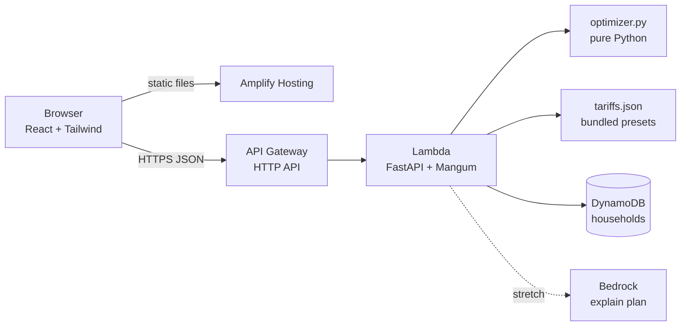

# SamayUrja - Architecture

## 1. Overview

A static React front end calls one Lambda function behind an HTTP API. The Lambda runs a FastAPI app that holds the optimizer and reads and writes one DynamoDB table. Everything is defined in one SAM template.



## 2. Components

| Component | Tech | Responsibility |
|---|---|---|
| Web app | React, Vite, Tailwind, Recharts | Appliance form, weekly grid, savings charts |
| Hosting | AWS Amplify Hosting | Build from the Git repo, serve over HTTPS |
| API | API Gateway HTTP API | Routing, CORS, throttling |
| Service | One Lambda, Python 3.12, FastAPI with Mangum | Validation, optimizer, persistence |
| Optimizer | `optimizer.py`, standard library only | Pure function: tariff + appliances → schedule + savings |
| Tariff data | `tariffs.json` in the Lambda package | Preset price and carbon curves |
| Store | DynamoDB, on-demand | One item per household |
| IaC and local dev | AWS SAM CLI | `sam local start-api`, `sam deploy` |

## 3. Decisions

| Decision | Chosen | Instead of | Reason |
|---|---|---|---|
| Compute | One Lambda | ECS, EC2, App Runner | Always-free tier, nothing to keep running, one deploy command |
| Framework | FastAPI with Mangum | Raw Lambda handlers | Pydantic validation and local `uvicorn` for free; the original brief asks for FastAPI |
| Database | DynamoDB | PostgreSQL, MongoDB | The only access pattern is get/put by household ID. RDS adds a VPC, cost and setup time for no benefit |
| Auth | None; household ID is a UUID in the URL | Cognito | Nothing sensitive is stored. Add Cognito if profiles ever hold personal data |
| Optimizer | Greedy, per-appliance sliding window | MILP solver (PuLP, OR-Tools) | With 48 slots and under 20 appliances, greedy is near-optimal, explainable, and has no native dependency to package for Lambda |
| Tariff source | Bundled JSON | Scraper or external API | No public discom ToD API exists. Presets are honest about being illustrative |
| Front-end hosting | Amplify Hosting | S3 + CloudFront | Connect the repo and it deploys; no bucket policy or distribution to configure |

## 4. API

Base URL: the HTTP API endpoint output by `sam deploy`. All bodies are JSON.

| Method | Path | Purpose |
|---|---|---|
| GET | `/tariffs` | List presets: id, name, 48 prices, 48 carbon intensities |
| POST | `/optimize` | Stateless. Body: profile. Returns schedule and savings |
| PUT | `/households/{id}` | Save profile |
| GET | `/households/{id}` | Load profile |

### Profile (request body for `/optimize` and `PUT /households/{id}`)

```json
{
  "tariff_id": "tod-domestic-illustrative",
  "sanctioned_load_kw": 5,
  "appliances": [
    {
      "name": "EV charger",
      "power_kw": 3.3,
      "duration_min": 240,
      "days_per_week": 7,
      "current_start": "19:00",
      "earliest_start": "09:00",
      "latest_end": "07:00"
    }
  ]
}
```

A window where `latest_end` is earlier than `earliest_start` wraps past midnight.

### `/optimize` response

```json
{
  "runs": [
    {
      "name": "EV charger",
      "current_start": "19:00",
      "new_start": "12:00",
      "days": [0, 1, 2, 3, 4, 5, 6],
      "monthly_saving_inr": 955,
      "monthly_saving_kg": 80,
      "note": null
    }
  ],
  "monthly": {
    "cost_before_inr": 3391,
    "cost_after_inr": 2436,
    "co2_before_kg": 318,
    "co2_after_kg": 238
  }
}
```

Values above show the shape; they are not computed output.

## 5. Data model

DynamoDB table `households`, partition key `id` (string, UUID v4 generated in the browser). No sort key, no indexes.

| Attribute | Type | Notes |
|---|---|---|
| `id` | S | Partition key |
| `profile` | M | The profile object from section 4 |
| `updated_at` | S | ISO 8601 |

Tariff preset, in `tariffs.json`:

```json
{
  "id": "tod-domestic-illustrative",
  "name": "ToD domestic (illustrative)",
  "base_inr_per_kwh": 8.0,
  "bands": [
    { "label": "solar",  "from": "09:00", "to": "17:00", "multiplier": 0.8, "kg_per_kwh": 0.60 },
    { "label": "peak",   "from": "18:00", "to": "22:00", "multiplier": 1.1, "kg_per_kwh": 0.80 },
    { "label": "normal", "multiplier": 1.0, "kg_per_kwh": 0.72 }
  ]
}
```

The service expands bands into two 48-element arrays (price, carbon) at load time. The unlabelled band is the default for slots no other band covers.

## 6. Repository layout

```
samayUrja/
├── docs/
├── backend/
│   ├── app.py              FastAPI routes + Mangum handler
│   ├── optimizer.py        pure functions
│   ├── tariffs.json
│   ├── test_optimizer.py
│   └── requirements.txt    fastapi, mangum, boto3 (boto3 is in the Lambda runtime)
├── frontend/               Vite + React + Tailwind
└── template.yaml           SAM: function, HTTP API, table
```

## 7. Security and limits

- Pydantic bounds: `power_kw` 0.05-25, `duration_min` 30-1440 in steps of 30, `days_per_week` 1-7, at most 20 appliances, `sanctioned_load_kw` 1-50.
- Household `id` must match a UUID pattern before it reaches DynamoDB.
- CORS restricted to the Amplify domain once it exists; `*` only during local development.
- API Gateway default throttling left on. The Lambda role has `GetItem` and `PutItem` on the one table and nothing else.

## 8. Local development

```
sam build && sam local start-api      # API on :3000, needs Docker or Finch
cd frontend && npm run dev            # VITE_API_URL=http://localhost:3000
cd backend && pytest
```

`sam local` runs the Lambda in a container. Finch is the AWS open-source alternative to Docker Desktop and also counts toward the "AWS open-source tool" criterion.
